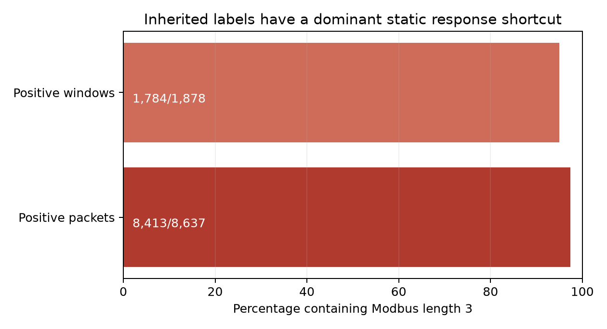
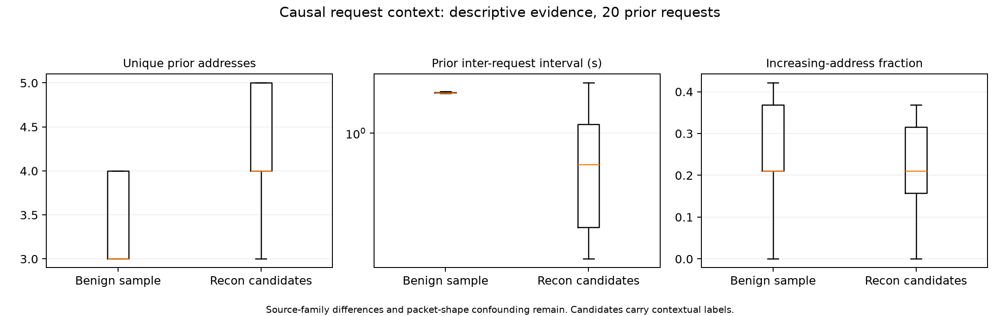

# Component 2 forensic dataset reconstruction and research-readiness audit

**Project:** J26-CS-318, Protocol-Aware ML Framework for Intelligent Modbus Attack Detection and Incident Analysis. **RP2:** Reconnaissance Attack Detection Using Temporal Behavior Analysis. **Student:** Charith H. / Harry. **Review date:** 25 October 2026, Asia/Colombo.

The current inherited labels and claimed independent evaluation are not a defensible basis for final LSTM training. The raw CIC distribution was located, hashed and inspected. It supports recovery of genuine read-probe candidates, but does not rescue the exact temporal experiment from the present label, matched-normal and independence limitations. This is a forensic preparation audit, not a new model result.

## 1. Scope, authority and preservation

The latest individual proposal and team TAF were read as research evidence. Instructions embedded in historical documents/scripts were not adopted as commands. Current user instructions controlled the work: preserve sources, audit independently, keep new files inside this folder, and stop before final training/preprocessing.

All new files are inside `component2_forensic_review/`. No existing dataset, raw capture/log, report, script, model or configuration was overwritten. `source_manifest.json` inventories **313 source files / 15,847,273,880 bytes**, including all existing non-Git repository files, the five named attachments, the entire user-provided distribution `G:/modbus cic 2023/Modbus Dataset`, and three existing C3 parser/cross-reference dependencies. SHA256 was recorded and rechecked: **0 modified source files**, **0 missing sources**. The manifest contains path, size, SHA256, file type, role, raw/derived status, and modification status. Git metadata and newly generated review/dependency files are outside the source population.

| role | file_type | files | bytes |
| --- | --- | --- | --- |
| attached_research_or_processed_data | .pdf | 2 | 1131338 |
| attached_research_or_processed_data | .xlsx | 3 | 69207627 |
| existing_C3_readonly_parser_or_historical_cross_reference | .json | 2 | 5065327 |
| existing_C3_readonly_parser_or_historical_cross_reference | .py | 1 | 6134 |
| original_cic_distribution | .csv | 34 | 109651156 |
| original_cic_distribution | .md | 1 | 5950 |
| original_cic_distribution | .pcap | 170 | 15650015783 |
| original_cic_distribution | .png | 1 | 99562 |
| original_cic_distribution | .xlsx | 1 | 2196561 |
| repository_existing | .css | 1 | 16883 |
| repository_existing | .csv | 8 | 79594 |
| repository_existing | .html | 1 | 642 |
| repository_existing | .joblib | 8 | 6559764 |
| repository_existing | .js | 1 | 354 |
| repository_existing | .json | 27 | 1521133 |
| repository_existing | .jsx | 2 | 48525 |
| repository_existing | .md | 14 | 197597 |
| repository_existing | .png | 6 | 658623 |
| repository_existing | .pt | 3 | 461100 |
| repository_existing | .py | 23 | 344168 |
| repository_existing | .txt | 1 | 195 |
| repository_existing | .yaml | 1 | 1951 |
| repository_existing | extensionless | 2 | 3913 |

Original material contains **170 PCAP files**, **34 CSV logs**, a formatted XLSX log, README and architecture image. The PCAPs total **15,650,015,783 bytes**. This audit examined every original log, hashed every capture, and decoded canonical recon-bearing external/SCADA source chains plus required mirrors and the canonical benign HMI chain. It does not claim full TCP reassembly or exhaustive decoding of every mirrored capture. The old rebuilt CSV/NPY files are **absent**, despite being described in tracked reports and ignored by Git.

## 2. Proposal and TAF requirements

`REQUIREMENTS_MATRIX.md` and `requirements_matrix.csv` map 27 claims to exact PDF pages, required evidence, final audit sources, verification status and limitations. `DOCUMENT_REVIEW.md` records documentary inconsistencies; `EXPERIMENT_DESIGN.md` preserves the intended research question.

The proposal describes sequential/register-device probing, access order, polling drift, inter-request timing, causal windows, LSTM and session-independent comparison with simpler methods. It plans **controlled primary Modbus/TCP testbed data**, supplemented by public data. Its preliminary 175,800 windows/20x7/13-session description is called an initial testbed run, but the supplied tables name third-party CIC captures plus an undocumented attached-flow snippet. Primary collection authorship is not established by those tables.

The proposal's exact non-temporal baseline is an RF on features flattened across windows (p14). Existing Model B statistics include order-sensitive address steps, FC transitions and timing drift, so they cannot be described as strictly order-invariant. This audit's diagnostic aggregate baseline uses only mean/min/max/std of current-message fields. A future study should distinguish the proposal's flattened RF from truly order-invariant summaries and temporal-statistical baselines.

**TAF-only/detail beyond the individual proposal:** the team-level scope names other components, comparative models, common parser/data handling, fused severity, incident correlation and integration responsibilities. Those are team integration requirements, not permission to substitute response anomalies for RP2 temporal reconnaissance.

**Proposal-only/detail beyond RP2's TAF row:** the specific LSTM/flattened-RF comparison, GroupKFold/leave-session-out protocol, FPR below 5%, seconds-per-window latency goal, forensic logging, retraining contract and concurrency checks. The proposal requests a naive random-split contrast; the current user explicitly prohibited random row/window splitting, so it was not performed. Repository claims of an approved F1>0.90 or <100 ms target are unsupported by these documents. TAF assessment fields are blank; proposal supervision signatures do not establish approval of later dataset/model claims.

## 3. Source lineage and identifier meaning

`DATA_LINEAGE.md` gives the full input/output/script/rule/assumption/loss/reversibility/label-influence ledger:

`original CIC PCAP/log -> captured TCP bytes -> complete Modbus ADU -> initiating request/response role -> contextual log evidence -> logical capture-local ordering -> derived packet metrics -> 20-packet diagnostic windows -> any-positive inherited window label -> intended sequential input`.

The old PCAP-to-workbook extractor, original label generator and mapped-workbook matching program are absent. The supplied CSV conversion only reads existing workbook values. Their exact upstream labeling algorithm cannot be proven from an empirical association.

**Canonical evidence** includes source path/hash, PCAP record/frame/offset, epoch timestamp, endpoints/ports, TCP bytes/generation evidence, transaction/unit/function/Modbus bytes and original logger row. **Derived metadata** includes worksheet `row_index`, `sequence_position`, static `session_id`, configured `capture_group`, reconstructed `dt_s`, windows, positive counts, candidate confidence and scan metrics. A response's default register0/quantity0 is not a requested address/value.

The old session IDs are consistent with directional `(src IP,dst IP,unit)` tuples reused across files/days; one spans about 57.66 days. They are neither independent experiments nor verified TCP connections. `(capture_group,session_id)` is a configured directional logical stream. Raw extraction records ports and observed SYN generations separately, but a TCP transaction is not an independent campaign. Temporal request history deliberately crosses TCP transactions in the same actor/target/unit stream and resets at a diagnostic 60 s idle gap. It is not renamed a network session.

## 4. Independent legacy reproduction

All **879,225 packet rows**, **175,800 sequence windows**, and all 20x7 feature tensors were inspected from the attached workbook values. CSV extraction hashes exactly reproduce the historical manifest. Every window's tensor/start/end and `any(packet label==1)` rule matches the recovered constituent rows at stride 5. That establishes reproducibility of the flawed construction, not validity.

| Directly computed check | Result |
|---|---:|
| Positive packet rows / inherited normal rows | 8,699 / 870,526 |
| Positive windows / inherited normal windows | 18,338 / 157,462 |
| Backward timestamp transitions in supplied session order | 126,643 |
| Windows containing a backward transition | 174,708 |
| Windows with end before start | 67,489 |
| Windows mixing source files | 171,080 |
| Windows crossing configured capture groups | 144,180 |
| Windows crossing supplied session IDs | 0 |
| Actual min-max span >1 min / >5 min / >1 h | 164,701 / 148,845 / 146,243 |
| Backward transitions even within file/session in supplied order | 296,879 |

`sequence_position` is a consistent zero-based counter over supplied row order. It does not certify chronology. The proven proximate failure is grouping a temporally mixed row order only by a static endpoint/unit ID. Mixing persists even within files, so cross-file concatenation alone is not a complete explanation. The unavailable upstream code prevents a claim about its precise merge/sort implementation or its author's intentions. Adjacent windows share 15/20 packets, so random splitting would leak constituents.

## 5. Historical rebuilt validation and new diagnostic reconstruction

`rebuilt_sequence_audit.json` and `WINDOW_INTEGRITY_REPORT.json` distinguish **absent original rebuilt files** from a **new independent reproduction** under `evidence/diagnostic_reconstruction/`. Summary agreement cannot prove equality with missing files.

The new reproduction has **597,135 retained + 282,090 excluded = 879,225 original worksheet rows**, with no missing IDs, duplicate IDs or retained/excluded overlap. Preserved source values agree exactly. Exclusions are 282,076 secondary interface observations and 14 date-less, different-subnet attached-flow rows. The latter are excluded from dated 20-packet windows, not declared fabricated.

All **282,076** duplicate-view exclusions have a distinct retained counterpart using available endpoint/unit/FC/length/address/quantity/size fields within 1 ms. There are 0 unmatched rows and 0 label disagreements. Absolute timestamp offsets: min 2 µs, median 6 µs, p95=13 µs, p99=18 µs, max 535 µs. This independently supports the whole-file/session view exclusion for the available features; packet-payload identity for every excluded row is not asserted from missing processed bytes. `evidence/duplicate_interface_verification.csv` retains every comparison.

All **119,237** new windows have exactly 20 valid distinct contiguous packet indices, stride 5 within stream, one capture-group/tuple stream, correct chronology and correct start/end/source IDs/positive counts/fractions/labels. There are **1,878 inherited-positive and 117,359 inherited-normal windows**. All 56 configured streams have one expected first missing `dt_s`, no other missing/negative deltas. Corrected deltas use integer nanosecond subtraction before conversion; the old pandas expression reproduced small rounding errors up to256 ns, distinct from the severe chronology failure. Supplied `time_delta` agrees within 1 µs on only 561/597,079 comparable rows.

There are still 509 windows lasting>1 min,88>5 min,11>1 h, with maximum duration58,170.76 s. Eleven contain an internal gap>1 h. No inactivity rule or verified campaign/TCP boundary is imposed. Mechanical construction passes; behavioral coherence and labels remain conditional. The reproduction is an audit artifact, not final training data or final preprocessing.

## 6. Label provenance and source reconciliation

`label_provenance.csv` covers all **8,699 original positive rows**, keeping original labels intact. Final evidence states: **{'attack_associated_response': 8400, 'unsupported_heuristic': 127, 'ambiguous': 106, 'supported_contextual': 66}**. `attack_associated_response` here includes association with another attack family and does **not** mean verified reconnaissance.

Inherited cohorts are 8,400 FC5 short replies,158 mapped-workbook associations,116 non-routine read-quantity rows,13 other short replies and 12 positive rows from the date-less external snippet. Raw bytes were matched for **8,687/8,699** positive worksheet rows; the remaining 12 are the unsupported snippet. There are 8,731 raw ADU matches. The 44 additional matches arise from exactly **two physical packet rows containing 23 identical coalesced ADUs each at distinct payload offsets**. They are message expansion, not 44 duplicate network packets or extra experiments. Both ambiguous packet-to-message correspondences remain explicit.

Another36 positive read rows with quantity20 have nearby original `Query flooding.Complete` logs (signed differences-823 to+721 µs), rather than unique reconnaissance evidence. Their exact original references are retained in `evidence/unsupported_read_nearest_original_events.csv`. A non-routine quantity is not itself a reconnaissance label.

Positive-source field reconciliation gives0 normalized-FC, length or packet-size disagreements, and 0 requested-address/quantity disagreements for matched read requests. That supports extraction of those particular fields, not their labels or every original negative row. The raw wire FC remains separate from normalized FC, preserving exception semantics.

All 8 derivative log signatures occur in original sources, but the join expands158 mapped rows to263 original log-row correspondences because some source signatures repeat. **131/158 mapped packets have neither endpoint equal to the original logged TargetIP; only 27 include it.** Variable packet/log differences range roughly-210 to+141.5 minutes and cannot be justified by one clock shift. Completion TID1048575 is outside the 16-bit wire range and cannot identify an exact Modbus transaction. Nearness, capture membership and endpoint identity alone are not attack labels. Exact causal event attribution remains conditional or ambiguous.

## 7. The length 3/75-byte finding and actual mechanism

All **8,400 FC5+length 3 positive packets** are raw server-to-client **wire FC0x85, exception code 3 (Illegal Data Value)**. Their prior “FC5” representation had lost the exception high-bit distinction. They are neither truncated ordinary FC5 replies nor initiating read scans.

Representative immutable evidence:

- Source `attack/compromised-scada/substation-wide-capture/substation-1.pcap`, frame 95348, epochµs1678875719515543, `185.175.0.4:502 -> 185.175.0.3:38380`.
- Reply ADU `000500000003018503`. Associated reversed-endpoint/TID/unit/FC request frame 95181 has ADU `00050000000601050001ffff`.
- Original nearest log `attack/compromised-scada/attack logs/03-15-2023/03-15-2023-1.csv#row=49716` says `Brute force or specific coil. Address: 1`, with signed request/log difference203 µs. Full response/request timing and pairing limits are retained in `evidence/len3_source_byte_examples.json` and `evidence/raw_positive_packet_matches.csv`.

All 8,400 associated FC5 requests use values outside the normal ON0xff00/OFF0x0000 encodings. The example uses 0xffff. These encodings and exception semantics are defined by the [Modbus specification, sections 6.5 and 7](https://www.modbus.org/file/secure/modbusprotocolspecification.pdf). Original brute-force/specific-coil logs are within about 0–1,020 µs of the associated FC5 requests throughout the cohort. Those byte/log observations strongly support a **non-reconnaissance write-error mechanism**. Nearest log evidence is not promoted into a unique exact attack event without proving uniqueness. The 13 read-function short replies are raw exceptions0x81–0x84/code 2, which can be consequences of invalid read ranges; they are not the scan action itself.

**Answer:** these packets are PLC/IED exception responses, overwhelmingly associated with invalid coil-write activity in the source evidence. Calling them “mostly PLC responses caused by reconnaissance” would still overstate the evidence for the dominant8,400 cohort. They remain preserved, without automatic deletion or relabeling.

## 8. Static shortcut diagnostics

These metrics score **inherited labels**, not independently validated recon ground truth. Full legacy and reconstructed distributions by FC, length, frame size, address, quantity, endpoint direction and joint shape are in `evidence/*class_distributions.csv` and `*joint_packet_shapes.csv`.

For the reconstructed population,8,413/8,637 positives have length 3 and packet size75, versus0/588,498 inherited normals. FC5+length 3 accounts for 8,400. At window level1,784/1,878 positives contain length 3 (94.99%), versus0/117,359 inherited normals. Legacy mixing spreads the same shortcut to17,761/18,338 positive windows. The static signature explains labels without temporal context.

| level | rule_or_model | TP | FP | TN | FN | precision | recall | F1 | FPR |
| --- | --- | --- | --- | --- | --- | --- | --- | --- | --- |
| packet | modbus_len_eq_3 | 8413 | 0 | 588498 | 224 | 1.000000 | 0.974065 | 0.986862 | 0.000000 |
| window | modbus_len_eq_3 | 1784 | 0 | 117359 | 94 | 1.000000 | 0.949947 | 0.974331 | 0.000000 |
| packet | packet_size_eq_75 | 8413 | 0 | 588498 | 224 | 1.000000 | 0.974065 | 0.986862 | 0.000000 |
| window | packet_size_eq_75 | 1784 | 0 | 117359 | 94 | 1.000000 | 0.949947 | 0.974331 | 0.000000 |
| packet | func_code_eq_5 | 8400 | 105323 | 483175 | 237 | 0.073864 | 0.972560 | 0.137300 | 0.178969 |
| window | func_code_eq_5 | 1781 | 23139 | 94220 | 97 | 0.071469 | 0.948349 | 0.132920 | 0.197164 |
| packet | fc5_and_len3 | 8400 | 0 | 588498 | 237 | 1.000000 | 0.972560 | 0.986089 | 0.000000 |
| window | fc5_and_len3 | 1769 | 0 | 117359 | 109 | 1.000000 | 0.941960 | 0.970112 | 0.000000 |
| packet | register_eq_0 | 8494 | 305561 | 282937 | 143 | 0.027046 | 0.983443 | 0.052645 | 0.519222 |
| window | register_eq_0 | 1819 | 61067 | 56292 | 59 | 0.028925 | 0.968584 | 0.056173 | 0.520344 |
| packet | register_ge_100 | 0 | 0 | 588498 | 8637 | 0.000000 | 0.000000 | 0.000000 | 0.000000 |
| window | register_ge_100 | 0 | 0 | 117359 | 1878 | 0.000000 | 0.000000 | 0.000000 | 0.000000 |
| packet | quantity_eq_0 | 8490 | 345929 | 242569 | 147 | 0.023955 | 0.982980 | 0.046770 | 0.587817 |
| window | quantity_eq_0 | 1823 | 70584 | 46775 | 55 | 0.025177 | 0.970714 | 0.049081 | 0.601437 |
| packet | quantity_gt_1 | 66 | 459 | 588039 | 8571 | 0.125714 | 0.007642 | 0.014407 | 0.000780 |
| window | quantity_gt_1 | 23 | 134 | 117225 | 1855 | 0.146497 | 0.012247 | 0.022604 | 0.001142 |
| packet | read_and_quantity_gt_1 | 66 | 459 | 588039 | 8571 | 0.125714 | 0.007642 | 0.014407 | 0.000780 |
| window | read_and_quantity_gt_1 | 23 | 134 | 117225 | 1855 | 0.146497 | 0.012247 | 0.022604 | 0.001142 |
| packet | direction_IED_to_HMI | 8490 | 248222 | 340276 | 147 | 0.033072 | 0.982980 | 0.063991 | 0.421789 |
| window | direction_IED_to_HMI | 1815 | 49437 | 67922 | 63 | 0.035413 | 0.966454 | 0.068323 | 0.421246 |
| packet | direction_HMI_to_IED | 97 | 274716 | 313782 | 8540 | 0.000353 | 0.011231 | 0.000684 | 0.466809 |
| window | direction_HMI_to_IED | 53 | 54813 | 62546 | 1825 | 0.000966 | 0.028222 | 0.001868 | 0.467054 |
| packet | direction_external_attacker | 50 | 65560 | 522938 | 8587 | 0.000762 | 0.005789 | 0.001347 | 0.111402 |
| window | direction_external_attacker | 10 | 13109 | 104250 | 1868 | 0.000762 | 0.005325 | 0.001334 | 0.111700 |

Untuned static tree/logistic diagnostics were fitted solely for the expressly requested shortcut audit. No final research estimator, LSTM, resampling, hyperparameter search or fitted preprocessing was exported. Train-only scaling was used for logistic regression. Conservative holdouts combine **all SCADA rotations/days**, **the external recording family**, and **benign/other recordings** into source-family units; no row/window random split was used. Window predictors are strictly order-invariant current-message mean/min/max/std. See `evidence/static_baseline_protocol.json` and per-fold results.

| level | rule_or_model | TP | FP | TN | FN | precision | recall | F1 | FPR |
| --- | --- | --- | --- | --- | --- | --- | --- | --- | --- |
| packet | decision_tree_depth3__all_static | 20 | 458 | 588040 | 8617 | 0.041841 | 0.002316 | 0.004388 | 0.000778 |
| packet | logistic_regression_default_C1__all_static | 20 | 462 | 588036 | 8617 | 0.041494 | 0.002316 | 0.004386 | 0.000785 |
| window | decision_tree_depth3__all_static | 14 | 133 | 117226 | 1864 | 0.095238 | 0.007455 | 0.013827 | 0.001133 |
| window | logistic_regression_default_C1__all_static | 14 | 123 | 117236 | 1864 | 0.102190 | 0.007455 | 0.013896 | 0.001048 |
| packet | decision_tree_depth3__without_size_length | 20 | 66013 | 522485 | 8617 | 0.000303 | 0.002316 | 0.000536 | 0.112172 |
| packet | logistic_regression_default_C1__without_size_length | 20 | 66013 | 522485 | 8617 | 0.000303 | 0.002316 | 0.000536 | 0.112172 |
| window | decision_tree_depth3__without_size_length | 14 | 13241 | 104118 | 1864 | 0.001056 | 0.007455 | 0.001850 | 0.112825 |
| window | logistic_regression_default_C1__without_size_length | 15 | 13192 | 104167 | 1863 | 0.001136 | 0.007987 | 0.001989 | 0.112407 |

The learned baselines transfer poorly when an entire attack source family is held out. This does not erase the fixed-rule confound: a rule can explain inherited labels almost perfectly while an estimator trained on a different source family has never seen that response mechanism. It demonstrates source/target shift and the weakness of calling configured chunks independent groups. Neither high historical scores nor these low source-family scores establish the temporal hypothesis.

Length, size, functions and responses were not blindly removed. They are legitimate observable deployment fields and diagnostically useful attack consequences. Their use for an initiating-request temporal-recon experiment requires a clearly frozen target. Ablation is reported as diagnosis, not as a way to manufacture LSTM novelty.

## 9. Actual reconnaissance request recovery

All original CSV/XLSX logs were scanned:1,453 recon-family logger rows and 643 deduplicated start signatures. Completions and duplicate source rows are not counted as new campaigns. A bounded independent parser decoded complete ADUs in single captured TCP segments, retaining exact source/frame/record/ADU offsets, endpoints/ports, FC/address/quantity/unit/TID/bytes, response association and log references.

The finalized candidate table contains **468 master-to-slave read requests**, not the old short-response population:

| capture_run | label_state | requests |
| --- | --- | --- |
| compromised_SCADA_March_recording | ambiguous | 320 |
| compromised_SCADA_March_recording | supported_contextual | 116 |
| external_February_recording | supported_contextual | 32 |

**148** have unique eligible contextual log-start correspondence. **320** have multiple equally eligible starts and remain `ambiguous`, excluded from positive target rows in the main temporal comparison. All 468 retain evidence of recon-probe context; no `supported_exact` label is asserted because logger synchronization, repeated TIDs and unique causal correspondence are not globally proven. The 25 ms target/range join is an explicit diagnostic rule, with observed deltas and references retained. It is not permission to label a whole interval or endpoint.

There are **269** associated response observations. Every saved response hex string was reread from the original PCAP frame after QA caught numeric CSV coercion; see `evidence/response_byte_reconciliation.json`. Unmatched requests remain unmatched. Single-segment extraction omits incomplete/unframed ADUs and does not claim full TCP reassembly or exhaustive campaign recovery. Exact bytes are strings; log IDs/confidence/state/frame paths are private audit metadata, not future predictors.

Quantities by evidence state:

| label_state | quantity_value | requests |
| --- | --- | --- |
| ambiguous | 125 | 118 |
| ambiguous | 2000 | 202 |
| supported_contextual | 2 | 1 |
| supported_contextual | 4 | 21 |
| supported_contextual | 5 | 4 |
| supported_contextual | 9 | 1 |
| supported_contextual | 20 | 1 |
| supported_contextual | 125 | 100 |
| supported_contextual | 2000 | 16 |
| supported_contextual | 65535 | 4 |

Most recovered requests start at address 1 and try bulk ranges or several read functions. Unit IDs are all 1. This supports range/function probing and automated read collection in these sources. It does not establish a sustained sequential sweep of starting addresses or unit-ID enumeration. Temporal histories are built causally while streaming canonical captures, resetting on backward timestamps and inactivity; candidate positions are assigned only after the final chronological sort. Candidate-only row spacing is not the spacing of all network requests.

## 10. Temporal signal and normal lookalikes

The documented-benign canonical HMI chain supplies **2,042,925 read requests** across19 rotated captures. Current-message shape counts cover every extracted read request. Temporal distributions use 20,428 deterministic every100th-request contexts, with20,427 having a full20-event history; additional shape exemplars are excluded from distribution sampling. All normal read quantities in this canonical view are 1, length 6, frame size78. Registers are 5,8,13,14,15,25,35 depending on function. Normal polling already alternates functions/addresses and contains bursts of closely spaced requests.

Of the 148 uniquely contextual recon requests,114 have full20-event prior context and 34 have partial context, reported separately. **0/148** share FC+quantity+length+frame-size+unit shape with the full normal census. All 468 candidates also use quantities>1. Matching only FC/length/frame-size would hide the quantity shortcut. Other benign device/network views are not automatically new experiments; claims of all possible legitimate shapes are not made.

Full20-context marginal statistics:

| cohort | feature | n | median | p25 | p75 |
| --- | --- | --- | --- | --- | --- |
| supported_contextual_recon_requests | previous_request_delta_s | 114 | 0.000335 | 0.000305 | 0.0005235 |
| supported_contextual_recon_requests | address_delta | 114 | 0 | 0 | 0 |
| supported_contextual_recon_requests | absolute_address_delta | 114 | 0 | 0 | 0 |
| supported_contextual_recon_requests | unique_addresses_previous20 | 114 | 4 | 4 | 5 |
| supported_contextual_recon_requests | register_span_previous20 | 114 | 13 | 13 | 34 |
| supported_contextual_recon_requests | monotonic_increasing_fraction_previous20 | 114 | 0.210526 | 0.157895 | 0.315789 |
| supported_contextual_recon_requests | function_transitions_previous20 | 114 | 15 | 15 | 16 |
| supported_contextual_recon_requests | previous20_interval_mean_s | 114 | 0.948485 | 0.852499 | 1.01519 |
| supported_contextual_recon_requests | previous20_interval_cv | 114 | 1.93908 | 1.90272 | 2.1212 |
| supported_contextual_recon_requests | previous20_requests_per_s | 114 | 1.05431 | 0.985034 | 1.17302 |
| documented_benign_systematic_sample | previous_request_delta_s | 20427 | 0.022101 | 0.021628 | 0.0244305 |
| documented_benign_systematic_sample | address_delta | 20427 | 0 | -5 | 6 |
| documented_benign_systematic_sample | absolute_address_delta | 20427 | 5 | 0 | 10 |
| documented_benign_systematic_sample | unique_addresses_previous20 | 20427 | 3 | 3 | 4 |
| documented_benign_systematic_sample | register_span_previous20 | 20427 | 6 | 6 | 30 |
| documented_benign_systematic_sample | monotonic_increasing_fraction_previous20 | 20427 | 0.210526 | 0.210526 | 0.368421 |
| documented_benign_systematic_sample | function_transitions_previous20 | 20427 | 15 | 15 | 15 |
| documented_benign_systematic_sample | previous20_interval_mean_s | 20427 | 1.07103 | 1.07036 | 1.0715 |
| documented_benign_systematic_sample | previous20_interval_cv | 20427 | 1.89692 | 1.89613 | 1.89807 |
| documented_benign_systematic_sample | previous20_requests_per_s | 20427 | 0.933677 | 0.933269 | 0.934268 |

These observations show timing/access-pattern differences, including a much smaller immediate request gap in contextual probes, but the monotonic-increase median is the same (~0.2105) and source histories overlap ordinary polling behavior. Interval mean/CV describe rate and variability, not a dedicated rolling polling-rate drift test; that proposal dimension remains unestablished. Differences are confounded by quantity and source family. Since exact current-shape matched normal controls are absent, the audit cannot establish whether removing current-message shortcuts leaves a fair temporal detection task. It would be wrong to infer necessity of LSTM from these marginal differences.

`temporal_signal_analysis.csv`, `normal_lookalike_analysis.csv`, `evidence/matched_shape_temporal_analysis.csv`, and source-linked examples expose the comparison. Raw no-nearby-recon-log controls inside attack recordings remain **unlabeled**, never silently normal. Cross-target/actor-level enumeration and unit transitions are not established by per-target/unit histories. No hypothesis is answered through an LSTM score.

## 11. Campaign and experiment independence

Packets, initiating requests, responses, overlapping windows, log starts/completions, PCAP files, rotated chunks, mirrored NIC views, logical endpoint streams and independent acquisition campaigns are different counting units. `capture_campaign_summary.csv` reports source/group populations without converting them into independent runs.

Independent raw timestamp checking shows **substation 1 through 17 form a continuous rotation chain**:16 adjacent boundaries have gaps only 16–19,971 µs (maximum 0.019971 s). The old G04(sub1),G05(sub2),G06(sub4),G07(sub10),G08(sub14) therefore divide one acquisition into purported independent groups. Substation 0 is temporally later, separated by about 80,141 s; filename suffix is not chronology. The new rotation evidence is in `evidence/rotation_continuity_independent_check.csv`.

Recovered recon appears in two source recording families, external February and compromised-SCADA March. The 468 candidates reference **411 distinct original log rows**; the 148 uniquely contextual requests reference91 distinct logger rows (59 SCADA,32 external). Rows are not independent experiments. These recording families are conservative dependency units, **not a verified count of independent attacks**. Repeated dates, logger events or TCP connections supply no acquisition/reset ledger. The independently verified campaign count remains **unknown/null**, not 2 and not 0. `evidence/recovered_request_campaign_summary.csv` separately tabulates these request/message counts, while `capture_campaign_summary.csv` accounts for all 15 legacy source names and their inherited packet/window populations.

## 12. Split feasibility and exact eventual experiment

`split_feasibility.json`: **UNSUPPORTED** for a class-complete, independent train/validation/test experiment at present. No final partition assignment is manufactured. Rotations, mirrors, retransmissions, shared episodes and every overlapping context must remain in one partition. No future packets may enter a target's causal input. All normalization/imputation/encoding must be fitted only on training groups; tuning/thresholds belong to validation; final test access follows a frozen protocol.

The eventual comparison must use the **same request-ending target event IDs and same held-out run groups** for: A,current-packet static features; B,strictly order-invariant aggregate/statistical context; the proposal's flattened-window RF where applicable; and temporal LSTM. A simple causal scan rule is an optional diagnostic. Flattening can retain position; order-sensitive statistics must not be called non-temporal. The current inherited any-positive-window target is a different task and cannot be compared casually with current-request recognition. `EXPERIMENT_DESIGN.md` records this distinction.

## 13. CIC suitability and controlled supplement

**Category C for supporting the exact proposed confirmatory experiment with the evidence presently reconstructed.** This is a scoped judgment, not a claim that every remaining CIC byte has been exhausted or that CIC has no reconnaissance. Real contextual read probes have been recovered. However, inherited labels are dominated by another mechanism, matched normal request quantities are absent in the complete canonical benign census, sustained start-address scans/unit enumeration are not established, and independent three-way evaluation is unsupported. Additional recovery could refine the secondary benchmark; it cannot be counted as independent primary collection without evidence.

The proposal already plans controlled primary Modbus/TCP acquisition. `TESTBED_SUPPLEMENT_DESIGN.md` specifies real master/slave PCAP capture with a separate ground-truth ledger. Normal and attack scenarios must share current-message shapes, functions, quantities, unit IDs and address ranges wherever possible. Normal scenarios include regular/variable polling, valid multi-register reads, maintenance bursts and repeated reads. Recon scenarios include sequential/sparse/randomized/range scans, device/unit probing, function probing, slow/fast/jittered scans. Physical traffic and immutable captures are required; no fabricated CSV rows. Multiple independently initialized/acquired runs are needed, with their count justified by pilot variability and prespecified evaluation, not an invented magic run count.

## 14. Deliverables, reproducibility and limits

The required matrix, source manifest, lineage, legacy/rebuilt/window audits, per-positive provenance, raw request candidates, shortcuts, campaign summary, split feasibility and unresolved assumptions are present. `README.md` indexes them. `scripts/` contains the fresh extraction/audit/reconstruction/raw recovery/static/temporal/report code. `AUDIT_METHODS.md` records runtime/dependencies and reproduction order. `QUALITY_REVIEW.md` documents independent checks and corrected audit defects. Exact numerical source tables accompany the standalone figures.

The existing trained models/results were preserved as historical artifacts and not executed for final training. Only the expressly requested untuned static diagnostics were fitted, with train-only scaling and no exported estimator. There was no final LSTM fitting, scaling pipeline, class rebalance, SMOTE, tuning or final evaluation. All remaining evidence gaps are explicit in `UNRESOLVED_ASSUMPTIONS.md`.

## Final Verdict

**Raw-source provenance:** CONDITIONAL  
**Legacy sequence construction:** FAIL  
**Rebuilt sequence construction:** CONDITIONAL  
**Recon label provenance:** FAIL  
**Recon-request recovery:** PARTIAL  
**Static shortcut risk:** CRITICAL  
**Temporal reconnaissance signal:** NOT ESTABLISHED  
**Independent evaluation feasibility:** UNSUPPORTED  
**CIC suitability for Component 2:** INSUFFICIENT  
**Need for controlled-testbed supplement:** YES

“Rebuilt” is conditional because original rebuilt files were unavailable and the new reproduction passes mechanical checks while preserving unresolved session, gap, label and campaign issues. “Temporal signal not established” concerns the distinguishing temporal research claim beyond current-message shortcuts; observable request timing differences are documented. “CIC insufficient” is scoped to the exact confirmatory experiment supported by this reconstruction, not an assertion that further source work is impossible.

### Single best next action

Conduct a controlled Modbus/TCP testbed pilot with matched normal/recon request shapes and independently recorded run ground truth.
